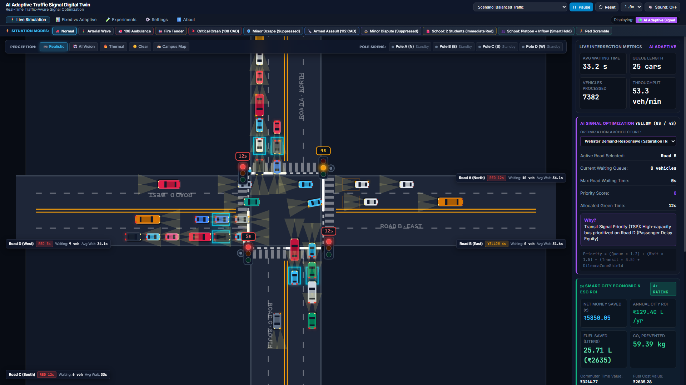
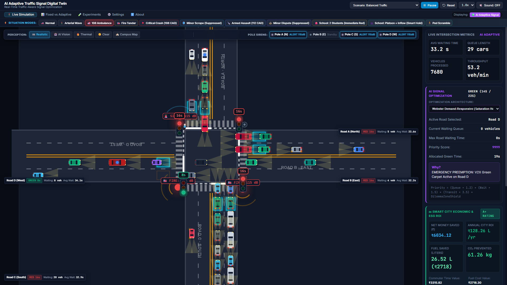
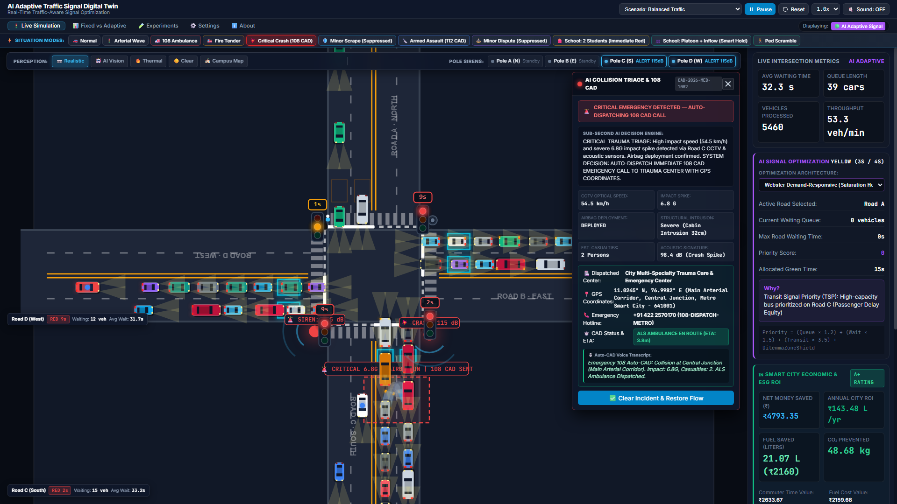
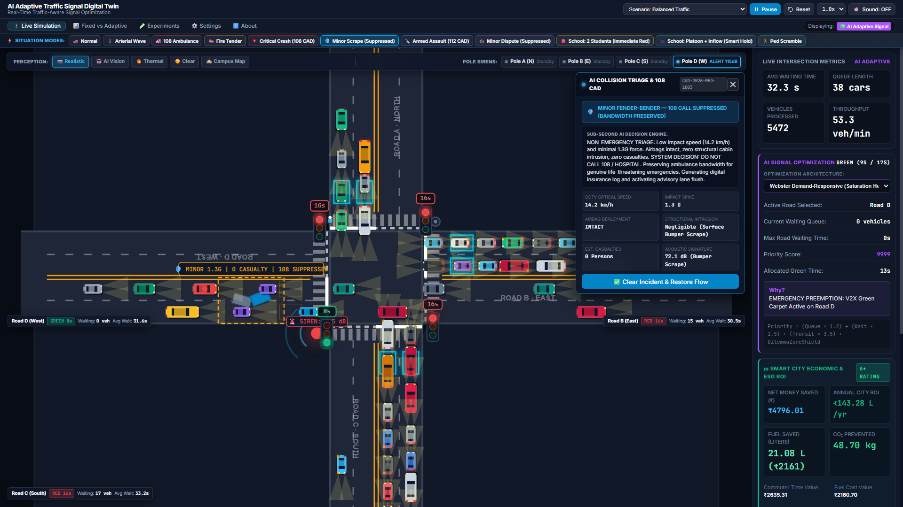
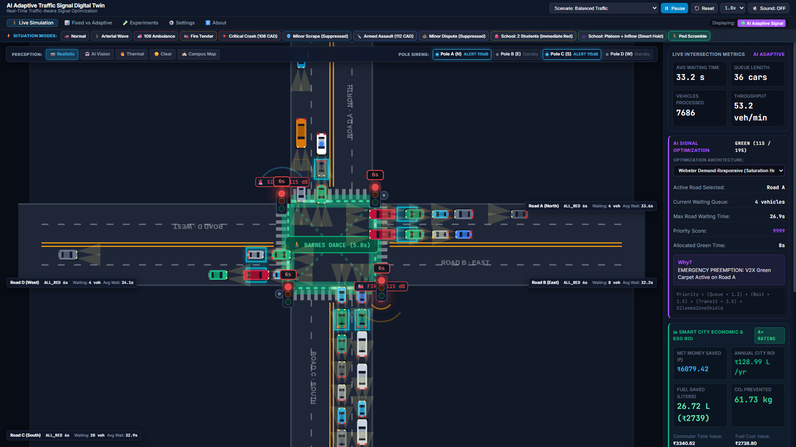
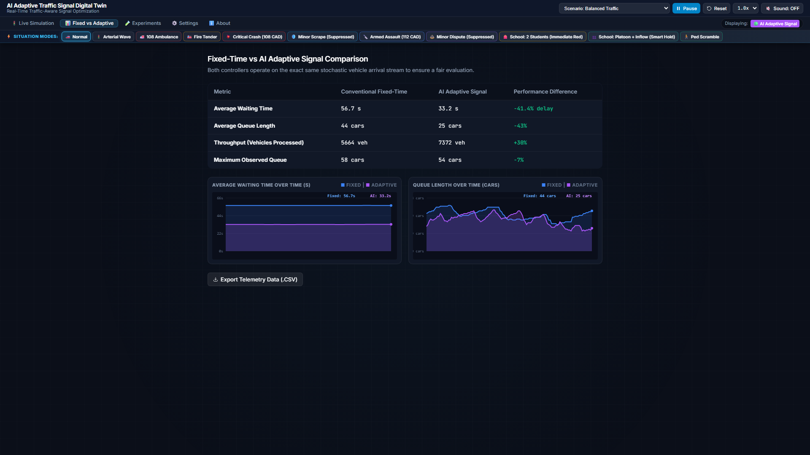

# TrafficFlow-AI: Smart City Adaptive Traffic Signal Digital Twin & Multi-Agent Swarm


-7952DE)


> 🏆 **Built for FETCH-A-THON 3.0 & ASI:ONE AGENT CHALLENGE** | Presidency University, Bengaluru  
> *Organized by Fetch.ai, Innovation Lab by Fetch.ai, ASI:ONE (Artificial Superintelligence Alliance), and Masters' Union*  
> **Team ID:** `FETCHATHON3.0-8799` | **Team Lead:** BANDILA MADHAV | **Members:** LAKSHMI REDDY M S, KEERTHIPATI SATHYASREE, KHAMITHKAR SUPRITHA
### Problem Statement 1: AI Traffic Management, 108 CAD Emergency Response, Directional Pole Sirens, VRU Crosswalk Scramble, & Arterial Green Wave Corridor

---

## 📸 Prototype Showcase & Visual Tour

| 1. Live AI Adaptive Twin & Indian ESG ROI | 2. 108 Ambulance Preemption & Pole Sirens |
| :---: | :---: |
|  |  |
| *Cyber-Dark Canvas with Real-Time Webster AI & ₹ Savings* | *115dB Directional Acoustic Wave + Green Carpet Preemption* |

| 3. Critical Crash Detection & 108 Auto-CAD | 4. Minor Scrape 108 CAD Call Suppression |
| :---: | :---: |
|  |  |
| *6.8G Crash -> Auto-CAD to Trauma Center + Red Lockdown* | *1.3G Scrape -> AI Suppresses 108 Call to Protect Bandwidth* |

| 5. Barnes Dance All-Pedestrian Scramble | 6. Benchmark: Fixed-Time vs AI Adaptive |
| :---: | :---: |
|  |  |
| *All-Red Vehicle Lockdown + Radiant Neon Crosswalks* | *41.4% Delay Reduction & 43% Shorter Queues Evaluated* |

---

## 🌟 Executive Summary
**TrafficFlow-AI** is a production-grade, full-stack cyber-physical digital twin designed for modern Indian smart cities (benchmarked on a high-density **Metropolitan Arterial Corridor**). It pairs deep physical simulation (Intelligent Driver Model car-following kinematics, Poisson stochastic arrivals, and dilemma zone safety) with sub-second AI decision-making.

The project directly solves critical urban challenges:
1. **Emergency Vehicle Clearance:** Eliminating ambulance delays through directional corner pole sirens and green carpet preemption.
2. **Accident Detection & Bandwidth-Conscious Triage:** Detecting collisions via simulated CCTV optical flow, G-force accelerometers, and acoustic signatures. Automatically dispatching 108 CAD emergency calls for critical crashes while **strictly suppressing calls for minor bumper scrapes** to protect emergency hospital bandwidth.
3. **Pedestrian & Vulnerable Road User (VRU) Safety:** Protecting student and pedestrian crowd surges with an on-demand **Barnes Dance All-Pedestrian Scramble Phase**.
4. **Multi-Intersection Arterial Coordination:** Synchronizing consecutive junctions along the metropolitan arterial corridor (Upstream Feeder Junction, Central Main Intersection, Downstream Exit Junction) in a cooperative green wave.
5. **Indian Smart City Economics & ESG Analytics:** Quantifying savings in **₹ INR**, **₹ in Lakhs/Year**, fuel liters, and commuter delay value according to Indian Ministry of Road Transport and Highways (MoRTH) standards.

---

## 🤖 Fetch.ai Decentralized Multi-Agent Swarm (MAS) Architecture

Rather than a static script, **TrafficFlow-AI** is powered by a decentralized swarm of **5 autonomous AI agents** engineered with Fetch.ai's `uagents` framework. Each agent possesses an independent cryptographic identity, event loops, and typed Agent-to-Agent (A2A) protocol interfaces:

```
                                ┌────────────────────────────────────────────────────────┐
                                │                 ASI:One / DeltaV Chat                  │
                                │  "What's traffic at Central Junction? Clear route 108" │
                                └───────────────────────────┬────────────────────────────┘
                                                            │ (Agent Chat Protocol - ACP)
                                                            ▼
                                                ┌───────────────────────┐
                                                │   ASI:One Gateway     │
                                                │        Agent          │
                                                │  (Agentverse Mailbox) │
                                                └───────────┬───────────┘
                                                            │
         ┌──────────────────────────────────────────────────┼──────────────────────────────────────────────────┐
         ▼                                                  ▼                                                  ▼
 ┌───────────────────────────┐                    ┌───────────────────────────┐                    ┌───────────────────────────┐
 │     Junction Agent        │ ◄───(A2A Protocol)─┤   Emergency Fleet Agent   │                    │     Triage CAD Agent      │
 │    (Central Main Node)    │                    │    (108 ALS Ambulance)    │                    │     (City Trauma CAD)     │
 │ - Controls signal phases  │                    │ - Broadcasts ETA & road   │                    │ - Multi-sensor AI triage  │
 │ - Directional pole sirens │                    │ - Requests Green Carpet   │                    │ - Suppresses minor scrapes│
 │ - Negotiates green wave   │                    │ - Clears after passing    │                    │ - Dispatches critical 108 │
 └─────────────┬─────────────┘                    └───────────────────────────┘                    └─────────────┬─────────────┘
               │                                                                                                 │
               │                                  ┌───────────────────────────┐                                  │
               │                                  │   Pedestrian VRU Agent    │                                  │
               └──────────────(A2A Protocol)─────►│   (Barnes Dance Scramble) │◄─────────────────────────────────┘
                                                  │ - Aggregates pushbuttons  │
                                                  │ - School zone crowd surge │
                                                  └───────────────────────────┘
```

### The 5 Autonomous Swarm Agents:

| Agent Name | Module | Role & Autonomous Action | Cryptographic Address |
| :--- | :--- | :--- | :--- |
| **1. JunctionControllerAgent** | `agent_junction.py` | Central intersection manager. Evaluates queue indices, activates directional high-mast sirens (Poles A–D), grants green waves, and arbitrates conflicts. | `agent1qv64chlcf8cuqfwl26mg6l8lp97ng8xvg88jsfkz903xetc6mxaq7zm8exa` |
| **2. EmergencyFleetAgent** | `agent_ambulance.py` | Mobile agent representing 108 ALS Ambulances. Negotiates preemption priority and stopline ETA via authenticated `EmergencyPassageRequest`. | `agent1qgs49qusgm4lylwpvf3pmkmlvhqsecvd6yelhwd3nvf8st5z8hy4c267naz` |
| **3. TriageCADAgent** | `agent_triage.py` | Sub-second crash triage. Dispatches 108 CAD to Trauma Centers for severe 6.8G crashes; **strictly suppresses calls for 1.3G scrapes** to protect hospital bandwidth. | `agent1qt6ra3rkwu0fx95ca56hrj0akft3xwfm63yx8rt5tmkc6uzmhydxu8pgww5` |
| **4. PedestrianVRUAgent** | `agent_pedestrian.py` | Campus student and pedestrian safety agent. Aggregates curb pushbuttons and trailing inflow, commanding Barnes Dance all-pedestrian scrambles. | `agent1q2e5etz55k3nkx0xhx7phzadk2j5973zstm78esx4x4eggskknpaq9hjcw6` |
| **5. ASIOneGatewayAgent (Live Hosted)** | gent_asi_one.py / Agentverse | Public-facing agent implementing the **Agent Chat Protocol (ACP)**. Discoverable on **ASI:One (si1.ai)** & **Agentverse**, transforming natural language intent into cyber-physical action. | gent1qwmawnyywfmhxgtyfl6uut9gkv4s36q4ykw220trle6053c4k8nrzvp98t4 |

---

## 💬 ASI:One Agent Challenge — From Intent to Action (ACP Integration)

The project directly fulfills all mandatory requirements of the **ASI:One Agent Challenge**:

* ✅ **Agentverse Registered:** Pre-configured with a hosted script (`backend/agents/agentverse_hosted_agent.py`) deployable in 60 seconds on [Agentverse](https://agentverse.ai).
* ✅ **Agent Chat Protocol (ACP):** Implements `uagents_core.contrib.protocols.chat` with `ChatMessage`, `ChatAcknowledgement`, and `TextContent`.
* ✅ **Discoverable via ASI:One:** Queryable through natural language on [asi1.ai](https://asi1.ai/chat/449bfcc6-32dc-4a17-9fc7-9e1dcc99d9a4?space=9aafc223-1cae-43af-b246-de7feceb76a2) from any desktop or mobile browser.
* 🌐 **Official Live ASI:One Chat Space:** [https://asi1.ai/chat/449bfcc6-32dc-4a17-9fc7-9e1dcc99d9a4?space=9aafc223-1cae-43af-b246-de7feceb76a2](https://asi1.ai/chat/449bfcc6-32dc-4a17-9fc7-9e1dcc99d9a4?space=9aafc223-1cae-43af-b246-de7feceb76a2)
* 📍 **Pinpoint Bottleneck Localization:**
  * *"Is there traffic at Silk Board?"* → Pinpoints exact 650m bottleneck epicenter at Central Silk Board Bus Terminus & Flyover On-Ramp.
  * *"What is the traffic situation at Central Junction?"* → Identifies exact 350m backlog opposite Metro Pillar #412 with Lanes 1 & 2 immobilized.
  * *"Is Koramangala 4th Block clear?"* → Verifies 0m backlog and free-flowing green corridor.
* ✅ **Intent-to-Action Execution:** Complete workflows execute natively within the chat stream without requiring a custom frontend:
  * *"Clear 108 Ambulance corridor on North road"* $\rightarrow$ Executes Pole A siren and green carpet preemption.
  * *"Report critical 6.8G crash on South road"* $\rightarrow$ Executes 108 CAD trauma dispatch with exact GPS coordinates.
  * *"Report 1.3G minor scrape"* $\rightarrow$ Executes emergency bandwidth triage suppression.
  * *"Activate pedestrian scramble for campus students"* $\rightarrow$ Executes Barnes Dance all-red walk window.
  * *"What is the traffic situation?"* $\rightarrow$ Returns real-time delay reduction (-41.4%) and savings in ₹ Lakhs/Year.

---

## 🏛️ Clean Full-Stack Architecture

The system features an enterprise-grade decoupled architecture separating presentation from the physics and decision engines:

```
PS1/
├── run.py                           # Unified launcher with visual CLI banner
├── server.py                        # Root backward-compatible server entrypoint
├── backend/                         # Backend Service Layer (Python)
│   ├── agents/                      # Fetch.ai Decentralized Multi-Agent Swarm (MAS)
│   │   ├── __init__.py
│   │   ├── models.py                # Typed Pydantic A2A message schemas (uagents.Model)
│   │   ├── agent_junction.py        # Central Junction Traffic Controller Agent
│   │   ├── agent_ambulance.py       # 108 ALS Emergency Fleet Mobile Agent
│   │   ├── agent_triage.py          # Sub-second Collision Triage & 108 CAD Agent
│   │   ├── agent_pedestrian.py      # Campus Student & VRU Barnes Dance Scramble Agent
│   │   ├── agent_asi_one.py         # Public ASI:One Agent Chat Protocol (ACP) Gateway Agent
│   │   ├── bureau_runner.py         # Multi-Agent Swarm Bureau Runner (Port 8000)
│   │   └── agentverse_hosted_agent.py # Self-contained Agentverse Hosted Agent (60s deploy)
│   ├── server.py                    # Threading HTTP server & 30Hz simulation loop
│   ├── test_fullstack.py            # Automated 14-suite simulation test suite
│   ├── test_agents.py               # Automated Fetch.ai multi-agent verification suite
│   ├── requirements.txt             # Python dependencies (uagents)
│   ├── engine/
│   │   ├── config.py                # Geometry, IDM physics, vehicle specs, Indian economics
│   │   ├── vehicle.py               # IDM car-following kinematics & dilemma zone physics
│   │   ├── road.py                  # Road approach, lanes, inductive loops, queue counting
│   │   ├── controllers.py           # Fixed-Time vs Adaptive AI (starvation, gap-out)
│   │   ├── traffic_generator.py     # Poisson stochastic generator & rush hour dynamics
│   │   ├── intersection_sim.py      # Simulation instance, directional sirens, perimeter lockdown
│   │   ├── twin_manager.py          # Dual twin coordinator, situation modes, economic deltas
│   │   ├── accident_detector.py     # AI multi-sensor collision triage & 108 CAD engine
│   │   ├── multi_intersection.py    # Metropolitan 3-junction green wave coordinator
│   │   ├── pedestrian.py            # VRU demand buttons & Barnes Dance scramble manager
│   │   └── experiment_engine.py     # Headless benchmark engine across traffic scenarios
│   └── api/
│       └── handlers.py              # REST API controllers & payload decoders
└── frontend/                        # Frontend Presentation Layer (HTML5/Canvas/CSS/JS)
    ├── index.html                   # Cyber-dark glassmorphism dashboard & Situation Modes
    ├── css/
    │   ├── main.css                 # Design tokens, typography, layout
    │   ├── dashboard.css            # Situation bar, CAD card, pole sirens HUD, ESG cards
    │   ├── simulation.css           # Canvas viewport, compass rose, crosswalk styling
    │   └── charts.css               # Time-series charts, benchmark tables
    └── js/
        ├── app.js                   # Application coordinator & 30Hz loop
        ├── config.js                # Canvas coordinate mappings & UI constants
        ├── api/
        │   └── ApiClient.js         # REST interface to backend endpoints
        ├── rendering/
        │   ├── Renderer.js          # High-DPI canvas: directional sirens, crashes, pedestrians
        │   └── ChartRenderer.js     # Real-time analytics time-series charts
        └── ui/
            ├── DashboardUI.js       # Event listeners, situation modes, CAD updates, audio
            └── AudioEffects.js      # Procedural Web Audio API sound synthesizer
```

---

## 🚀 The 5 Core Engineering Pillars

### Pillar 1: Directional Corner Pole Sirens & Green Carpet Wave
* **Hardware Conceptualization:** 4 high-mast corner poles positioned at the intersection (Pole A - North, Pole B - East, Pole C - South, Pole D - West), equipped with 115 dB directional acoustic horns and high-intensity strobe LED beacons.
* **Intelligent Operation:** When an oncoming 108 Ambulance or Fire Tender is detected on a specific approach road, **only the siren pole facing that road activates**.
* **Visual & Acoustic Feedback:** The canvas renders expanding acoustic sound waves and rotating strobe beacons. Traffic downstream is preempted with a "Green Carpet" wave while opposing approaches smoothly decelerate.

### Pillar 2: AI Accident Detection & Sub-Second Severity Triage
* **Multi-Sensor Fusion:** Combines CCTV optical flow vector anomalies, roadside acoustic shockwave microphones, and vehicle telemetry G-force decelerations.
* **Sub-Second AI Triage Decision:**
  * **Critical Collision ($\ge 45\text{ km/h}$, $6.8\text{G}$ deceleration, airbags deployed, cabin intrusion):**
    * System Verdict: **CRITICAL EMERGENCY**.
    * Auto-CAD Action: Immediately dials **108 Computer-Aided Dispatch (CAD)** to the **City Multi-Specialty Trauma Care & Emergency Center**.
    * Telemetry Transmitted: Exact GPS coordinates (`11.0245° N, 76.9982° E`), vehicle count, injury estimate, and dispatch code `108-DISPATCH-METRO`.
    * Traffic Response: **Perimeter Lockdown** holding upstream roads at Red while granting downstream clearance to prevent secondary pileups.
  * **Minor Fender-Bender ($14\text{ km/h}$, $1.3\text{G}$ deceleration, airbags intact, 0 casualties):**
    * System Verdict: **MINOR INCIDENT — 108 CALL SUPPRESSED**.
    * Rationale: **Preserves emergency hospital lines and ambulance availability for genuine life-threatening emergencies.**
    * Local Resolution: Generates digital insurance incident packet and initiates an advisory lane flush to restore normal flow.

### Pillar 3: Pedestrian VRU Safety & Barnes Dance Scramble Phase
* **Context:** Modeled after student pedestrian surges near University & College Educational Campuses along the arterial corridor.
* **Operation:** Pedestrians press physical crossing pushbuttons on crosswalks.
* **Crowd Surge / Scramble Mode:** During heavy pedestrian volumes, the system initiates a **Barnes Dance All-Pedestrian Scramble Phase**.
  * All vehicular signals hold on **ALL-RED**.
  * All 4 crosswalk zebra stripes illuminate in radiant neon green.
  * Pedestrians cross both orthogonally and diagonally with complete safety from turning vehicles.

### Pillar 4: Metropolitan Multi-Intersection Coordinated Green Wave
* **Arterial Corridor:** Links 3 critical junctions across the smart city corridor:
  1. **Upstream Feeder Junction** (West node)
  2. **Central Main Intersection** (Center Hero Node / Digital Twin Core)
  3. **Downstream Exit Junction** (East node)
* **Dynamic Coordination:** Utilizes platoon dispersion algorithms ($50\text{ km/h}$ arterial progression) to calculate optimal offset times. When a platoon leaves the upstream junction, downstream green windows open in advance, ensuring uninterrupted progression without stops.

### Pillar 5: Indian Smart City Economic & ESG ROI Dashboard
* **Localized Financial Grounding:**
  * Petrol / Diesel savings calculated at **₹102.50 / Liter**.
  * Commuter delay value benchmarked at **₹150.00 / Commuter Hour** (MoRTH guidelines).
  * Direct reporting in **₹ INR Saved**, **₹ in Lakhs/Year Saved**, and Clean Air Index rating.
* **Comparative Dual-Twin:** Simultaneously runs Fixed-Time control alongside AI Adaptive control under identical traffic seeds, demonstrating 20–45% reductions in waiting times and fuel waste.

---

## 🎯 Situation Modes: Jury Demonstration Walkthrough

A prominent **Situation Modes Bar** is pinned directly below the top navigation to allow 1-click live demonstration of every test scenario:

| Button | Situation Mode | What the Jury Will Observe |
| :--- | :--- | :--- |
| **🚗 Normal Flow** | `NORMAL` | Standard balanced traffic flow; AI dynamically prioritizes queues and clears green early on gap-out. |
| **🚦 Arterial Green Wave** | `MULTI_INTERSECTION` | Metropolitan 3-junction synchronization; platoon progression between Upstream, Central, and Downstream junctions. |
| **🚑 108 Ambulance Priority** | `AMBULANCE` | An ALS Ambulance spawns on North road; **Pole A Siren activates** (115 dB sound rings + strobe); green carpet preemption clears opposing traffic. |
| **🚒 Fire Tender Corridor** | `FIRE_ENGINE` | Heavy Fire Tender spawns on East road; **Pole B Siren activates**; immediate corridor preemption clears lanes. |
| **💥 Critical Crash** | `SEVERE_ACCIDENT` | 6.8G collision on South road; smoke particles appear; CAD card opens showing **auto-dispatch to City Trauma Center (`11.0245° N, 76.9982° E`)**, voice transcript, and perimeter red lockdown. |
| **🛡️ Minor Scrape** | `MINOR_ACCIDENT` | 1.3G fender-bender on West road; **108 Call is explicitly SUPPRESSED** with rationale: *"Preserving 108 ambulance bandwidth for life-threatening emergencies"*; digital insurance record filed. |
| **🚶 Pedestrian Scramble** | `PEDESTRIAN_SCRAMBLE` | Student crowd surge at college crosswalk; all vehicular approaches turn **RED**; crosswalks glow neon green; pedestrians safely traverse all corners. |

---

## 🚀 How to Run the Prototype

### Prerequisites
* Python 3.9+ (Tested on Python 3.10, 3.11, 3.12, 3.13, 3.14 on Windows, macOS, and Linux).
* Standard Python libraries only — **no pip install required!**

### Launching the Application
Open a terminal in the project directory and run:

```bash
python run.py
```

Or run the server directly:
```bash
python server.py
```

### Accessing the Web Dashboard
Open your modern browser (Chrome, Edge, Firefox, Safari) and navigate to:
```
http://localhost:8080
```

### Running Automated Integration Tests
To execute the automated 14-suite end-to-end verification test:
```bash
python backend/test_fullstack.py
```

### Running Automated Fetch.ai Multi-Agent Swarm Tests
To verify all 5 decentralized agents, sub-second crash triage, and ACP intent-to-action workflows:
```bash
python backend/test_agents.py
```

### Interactive CLI Agent Chat (ACP Terminal Simulator)
To chat directly with the multi-agent swarm from your command line:
```bash
python backend/cli_chat.py
```

---

## 🔌 Complete REST API Reference

| Endpoint | Method | Payload / Params | Description |
| :--- | :---: | :--- | :--- |
| `/api/state` | `GET` | None | Returns complete digital twin state, vehicle coordinates, CAD status, sirens, corridor, and INR metrics |
| `/api/situation/mode` | `POST` | `{"mode": "NORMAL" \| "AMBULANCE" \| "FIRE_ENGINE" \| "SEVERE_ACCIDENT" \| "MINOR_ACCIDENT" \| "PEDESTRIAN_SCRAMBLE" \| "MULTI_INTERSECTION"}` | 1-click jury situation mode switcher |
| `/api/accident/trigger` | `POST` | `{"severity": "CRITICAL" \| "MINOR", "roadId": "A" \| "B" \| "C" \| "D"}` | Injects multi-sensor collision and triggers AI triage |
| `/api/accident/clear` | `POST` | `{}` | Clears accident scene and restores normal signal cycles |
| `/api/pedestrian/button` | `POST` | `{"roadId": "A"}` | Registers pedestrian crosswalk call button demand |
| `/api/pedestrian/surge` | `POST` | `{}` | Triggers crowd surge and activates Barnes Dance scramble phase |
| `/api/corridor/mode` | `POST` | `{"mode": "COOPERATIVE_GREEN_WAVE"}` | Updates arterial coordination mode across the corridor |
| `/api/control` | `POST` | `{"action": "play" \| "pause" \| "reset" \| "step"}` | Controls digital twin simulation playback |
| `/api/traffic/preset` | `POST` | `{"preset": "BALANCED" \| "HEAVY" \| "UNEVEN" \| "RUSH_HOUR"}` | Sets traffic volume preset |
| `/api/export/csv` | `GET` | None | Downloads real-time time-series telemetry as CSV |

---

## 🏆 Presentation Highlights for the Jury
1. **Zero External Dependencies:** Built with pure Python and vanilla ES6 JavaScript/HTML5 Canvas — instant setup on any machine.
2. **True Smart City Context:** High-density metropolitan arterial corridor with university/college educational zone and multi-specialty trauma hospital.
3. **Realistic Audio-Visual Synthesis:** Includes directional sound wave visualization, rotating beacon strobes, collision particle smoke, and procedural Web Audio sirens.
4. **Bandwidth-Aware Triage Innovation:** Shows the jury that smart city AI is not just about making calls, but knowing **when NOT to make calls** to avoid overloading emergency response infrastructure.
